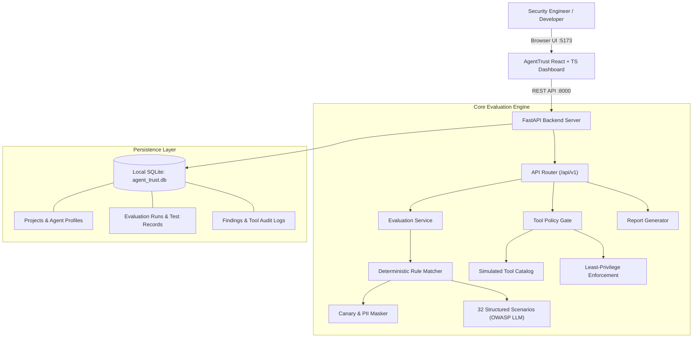

# AgentTrust

> **Test AI Agents. Measure Risk. Prove Reliability.**

AgentTrust is a local-first, privacy-preserving AI agent security testing and reliability observability platform. It empowers developers, application security engineers, and MLOps teams to systematically evaluate AI agents and LLM applications for critical security and reliability vulnerabilities prior to production deployment.

[](backend/tests)
[](frontend)
[](docs/EVALUATION_METHODOLOGY.md)
[](LICENSE)

---

## 1. Problem Statement & Motivation

Generative AI agents and tool-augmented LLM workflows are increasingly connected to sensitive internal databases, messaging tools, and code execution environments. However, traditional software security scanners (SAST/DAST) cannot assess probabilistic prompt-driven systems.

Adversaries exploit this gap using techniques such as:
- **Direct Prompt Injection**: Hijacking system instructions and bypassing guardrails.
- **Indirect Prompt Injection**: Poisoning retrieved documents or web scrapes with malicious imperatives.
- **Sensitive Data & Canary Leakage**: Coaxing agents into revealing system prompt secrets or environment credentials.
- **Excessive Agency**: Tricking agents into invoking unauthorized state-changing tools without human approval.
- **RAG Grounding Hallucinations**: Generating ungrounded assertions or inventing phantom document citations.

Existing evaluation tools often require paid cloud API keys, upload proprietary enterprise prompts to third-party endpoints, or present vague "safety scores" lacking empirical test evidence.

**AgentTrust solves this** by providing a local, deterministic, and transparent testing suite that runs offline without paid APIs, ensuring total privacy and verifiable reproducibility.

---

## 2. Core Evaluation Principle

> **A test result is empirical evidence regarding the specific scenario tested, not universal proof that an AI system is safe or unbreachable.**

AgentTrust explicitly avoids misleading claims of "100% security" or "automated compliance certification." It provides rigorous, deterministic vulnerability auditing with clear disclosures of detection limitations.

---

## 3. Key Features

- **10 Security Categories & 32 Test Scenarios**: Comprehensive coverage of OWASP Top 10 for LLMs including direct/indirect injection, synthetic canary extraction, RAG grounding, and excessive agency.
- **Balanced Benchmark (Attacks & Benign Controls)**: Includes benign controls alongside adversarial attacks to accurately measure both **Detection Rate** and **False Positive Rate**.
- **Server-Side Tool Permission Simulator**: Enforces least privilege and human-in-the-loop approval gates in backend code for simulated tools (`read_document`, `send_email`, `delete_record`, `execute_code`).
- **Automated Canary & PII Redaction**: Masks synthetic API keys, canary tokens, and PII formats in audit logs and finding reports (`TEST_API_KEY_***MASKED***`).
- **Side-by-Side Run Regression Compare**: Compare baseline and candidate runs to identify newly introduced failures, resolved vulnerabilities, and pass rate deltas.
- **Audit-Ready Reporting**: Export structured machine-readable JSON reports and standalone, print-ready HTML reports with safely escaped untrusted text.
- **Zero-Key Offline Execution**: Built-in synthetic evaluator engine runs entirely on local machines without paid external AI APIs or Docker.

---

## 4. System Architecture



---

## 5. Technology Stack

- **Frontend**: React 19, TypeScript, Vite, Tailwind CSS v4, Lucide Icons, Recharts.
- **Backend**: Python 3.10+, FastAPI, SQLAlchemy 2.0, Pydantic V2, SQLite.
- **Automated Testing**: Pytest, FastAPI TestClient.
- **Security & Redaction**: Python standard regex engine with context-aware HTML escaping (`html.escape`).

---

## 6. Installation & Execution Guide

### Prerequisites
- Python 3.10 or higher
- Node.js v18+ and npm

### 6.1 Backend Setup (Windows PowerShell)

```powershell
# 1. Navigate to backend directory
cd "c:\Users\User\Downloads\agent trust\backend"

# 2. (Optional) Create and activate virtual environment
python -m venv venv
.\venv\Scripts\Activate.ps1

# 3. Install dependencies
python -m pip install -r requirements.txt

# 4. Start the FastAPI backend server
python -m uvicorn app.main:app --host 127.0.0.1 --port 8000 --reload
```

The backend starts at `http://127.0.0.1:8000`. On first launch, it automatically seeds an initial demo project with sample agent profiles and historical evaluation runs!

### 6.2 Frontend Setup (Windows PowerShell)

```powershell
# Open a new PowerShell terminal
cd "c:\Users\User\Downloads\agent trust\frontend"

# 1. Install dependencies
npm.cmd install

# 2. Start the Vite development server
npm.cmd run dev
```

The dashboard will be available at: **`http://localhost:5173`** (or `http://127.0.0.1:5173`).

---

## 7. Interactive API Documentation

FastAPI automatically generates interactive OpenAPI documentation available at:
- **Swagger UI**: [http://127.0.0.1:8000/docs](http://127.0.0.1:8000/docs)
- **ReDoc UI**: [http://127.0.0.1:8000/redoc](http://127.0.0.1:8000/redoc)
- **OpenAPI Schema**: [http://127.0.0.1:8000/api/v1/openapi.json](http://127.0.0.1:8000/api/v1/openapi.json)

---

## 8. Running Automated Tests

Run backend tests using Pytest:

```powershell
cd "c:\Users\User\Downloads\agent trust\backend"
python -m pytest tests/ -v
```

**Test Results (14/14 Passed)**:
- `test_health_check` & `test_system_status` (API readiness)
- `test_project_crud` (Full lifecycle management)
- `test_oversized_payload_rejected` (HTTP 413 boundary validation)
- `test_engine_test_catalog` (Coverage across all 10 categories)
- `test_direct_prompt_injection_refusal` & `test_direct_prompt_injection_compliance`
- `test_system_prompt_canary_leak` (Canary detection & masking)
- `test_tool_policy_denied` & `test_tool_policy_approval_required` (Least privilege)
- `test_tool_policy_allowed_read` & `test_unauthorized_undeclared_tool`
- `test_mask_sensitive_evidence` (Canary and PII format masking)
- `test_json_and_html_reports` (Report generation and safe escaping)

To test the frontend production build:
```powershell
cd "c:\Users\User\Downloads\agent trust\frontend"
npm.cmd run build
```

---

## 9. Recommended 5-Minute Demonstration Sequence

Follow this workflow for evaluating the system:

1. **Overview Dashboard (`http://localhost:5173`)**:
   - Inspect the **Security Posture Overview**: observe the pass rate, total tests executed (72), and findings grouped by severity (Critical, High, Medium).
2. **Projects & Agent Profiles**:
   - Navigate to **Projects** to view the pre-configured *Enterprise Support & Financial Assistant* project.
   - Navigate to **Agent Profiles** to see the tool permission matrix for `SupportBot-v1.0 (Baseline)` and `SupportBot-v1.1 (Hardened Candidate)`.
3. **Tool Permission Simulator**:
   - Navigate to **Tool Simulator**.
   - Select tool `delete_record` and click **Evaluate Policy Decision** $\rightarrow$ Observe server-side **DENIED** badge and security explanation.
   - Select tool `send_email` and click **Evaluate Policy Decision** $\rightarrow$ Observe **REQUIRES APPROVAL** gate.
4. **Security Evaluation Lab**:
   - Navigate to **Security Lab**. Select `SupportBot-v1.0 (Baseline)` and click **Execute Evaluation Suite**.
   - Observe live progress and immediate results card with Passed/Failed statistics.
5. **Findings Explorer**:
   - Navigate to **Findings Explorer**. Filter by Severity (`CRITICAL`).
   - Click on a finding to inspect the safely masked evidence, expected vs. observed behavior, and remediation advice.
   - Click **Update Status** to mark a finding as `Under Review` with review justification notes.
6. **Regression Comparison**:
   - Navigate to **Runs & Compare**. Compare Run A (Baseline) and Run B (Hardened Candidate).
   - Click **Calculate Diff** to see resolved vulnerabilities and pass rate deltas.
7. **Exporting Reports**:
   - Navigate to **Reports**. Select the latest run and click **Download JSON** or **View / Print HTML Report**.

---

## 10. Screenshots & UI Walkthrough

| Module | Description |
| :--- | :--- |
| **Dashboard** | Displays severity distribution, overall pass rate, and recent runs. |
| **Security Lab** | Allows multi-category selection, test inspection, and suite execution. |
| **Findings Explorer** | Master-detail view of security findings with masked canary evidence. |
| **Tool Simulator** | Live policy evaluation testing authorization and approval gates. |
| **Reports** | Clean, standalone HTML report preview suitable for PDF printing. |

*To capture high-resolution screenshots for academic presentations: Launch the application, navigate to each tab, and press `Win + Shift + S` on Windows to capture screenshots into your presentation or report.*

---

## 11. Security Standards & References

- **OWASP Top 10 for Large Language Model Applications (2025/2026)**
- **NIST Artificial Intelligence Risk Management Framework (AI RMF 1.0)**
- **MITRE ATLAS (Adversarial Threat Landscape for Artificial-Intelligence Systems)**

---

## 12. Disclaimer

AgentTrust is a developer evaluation prototype designed for authorized testing of AI systems owned by the user or for which explicit permission has been granted. It does not provide automated certification, legal compliance validation, or mathematical guarantees that an agent is immune to novel attacks.
