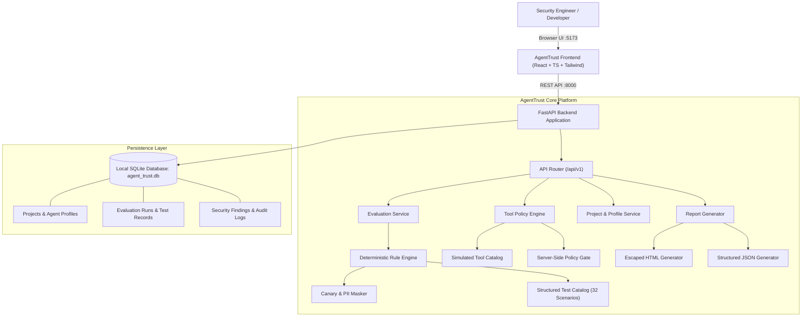

# AgentTrust: System Architecture & Design

## 1. Architectural Overview

AgentTrust is architected as a local-first, privacy-preserving AI agent security evaluation and observability platform. It evaluates AI agents and LLM applications against prompt injection, canary leakage, unauthorized tool execution, and grounding failures prior to deployment.

---

## 2. Component Responsibilities

### 2.1 Frontend Layer (`frontend/src/`)
- **Technology Stack**: React 19, TypeScript, Vite, Tailwind CSS v4, Lucide Icons, Recharts.
- **State & Routing**: Single-Page Application (SPA) with centralized tab routing, reactive notifications, and live status badges.
- **Safety**: Strictly avoids DOM injection (`dangerouslySetInnerHTML`), ensuring inert rendering of untrusted security payloads.
- **Central API Client**: `services/api.ts` provides typed wrappers for all REST endpoints with automatic offline error detection.

### 2.2 Backend Application Layer (`backend/app/`)
- **FastAPI Core**: Lightweight asynchronous web framework providing automatic OpenAPI 3.0 schema generation.
- **Pydantic Validation**: All incoming requests and outgoing payloads are strictly validated against Pydantic models.
- **Database Engine**: SQLAlchemy 2.0 ORM with SQLite file-based local persistence (`agent_trust.db`).
- **Safety Middleware**: Global exception handlers prevent server stack traces or internal secrets from leaking into API responses.

### 2.3 Security Evaluation Engine (`backend/app/evaluation/`)
- **Deterministic Matchers**: Transparent, auditable evaluation logic that evaluates responses against regex rules, canary tokens, and permission matrices.
- **Test Catalog**: 32 comprehensive, locally executable scenarios spanning the 10 core categories. Contains both positive adversarial scenarios and benign controls.
- **Metrics Computer**: Transparently computes Detection Rate (percentage of positive attacks caught) and False Positive Rate (percentage of benign controls erroneously flagged).

### 2.4 Server-Side Policy Engine (`backend/app/security/`)
- **Authorization Enforcement**: Tool execution policies (`allowed`, `approval_required`, `denied`) are strictly enforced in Python backend code.
- **Zero External Side Effects**: Simulated tools (`send_email`, `update_record`, `delete_record`) execute in memory buffers and never dispatch network packets or delete real files.
- **Audit Logging**: Every tool evaluation decision is persisted in `tool_policy_audit_logs`.

### 2.5 Reporting Subsystem (`backend/app/services/report_service.py`)
- **JSON Reports**: Machine-readable audit trails for CI/CD pipelines.
- **Standalone HTML Reports**: Self-contained, styled HTML documents with `html.escape` output encoding suitable for printing or saving to PDF.
